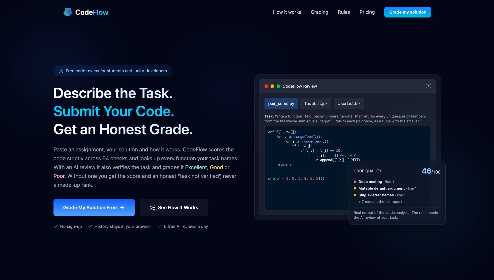
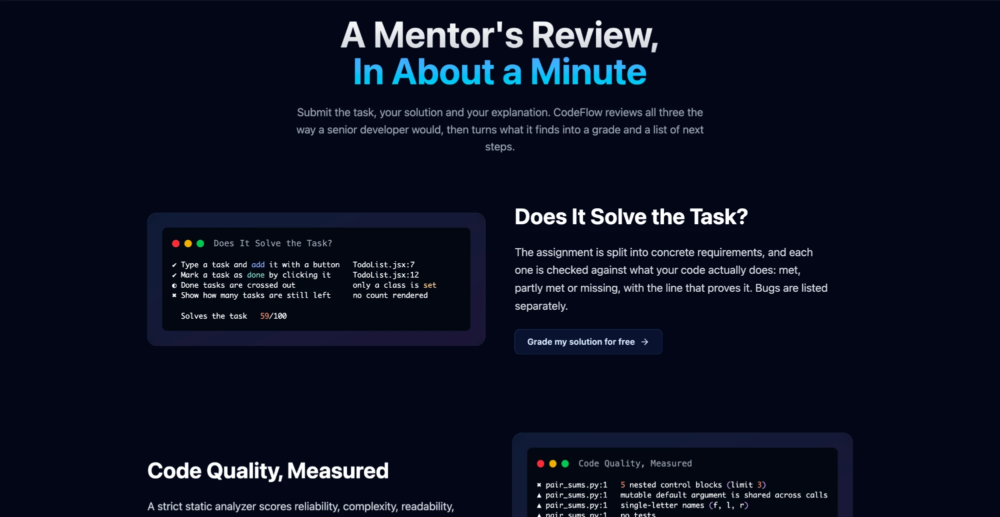
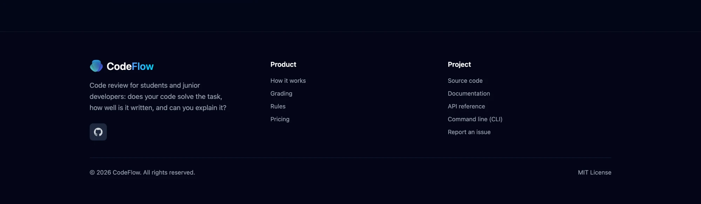
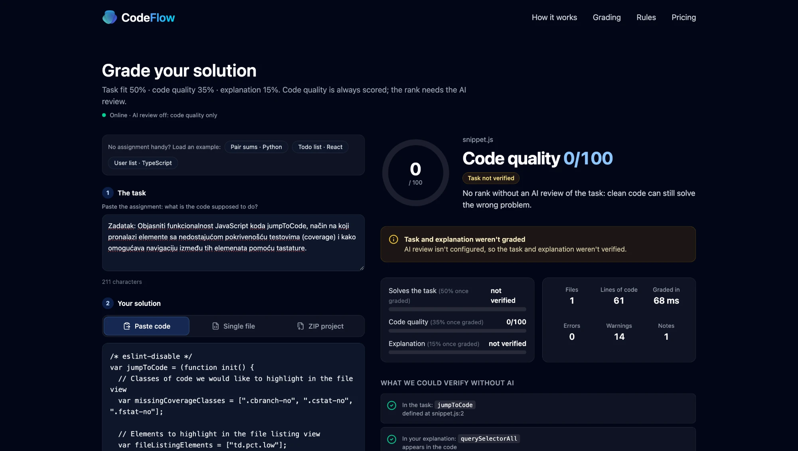
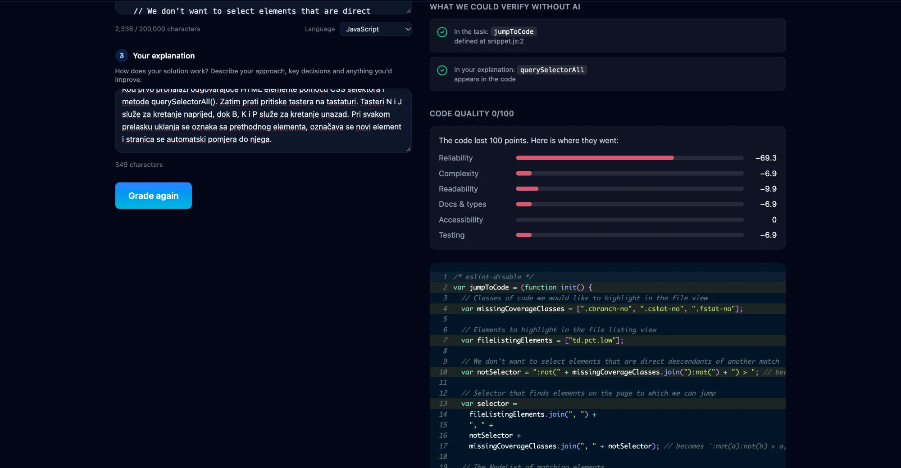
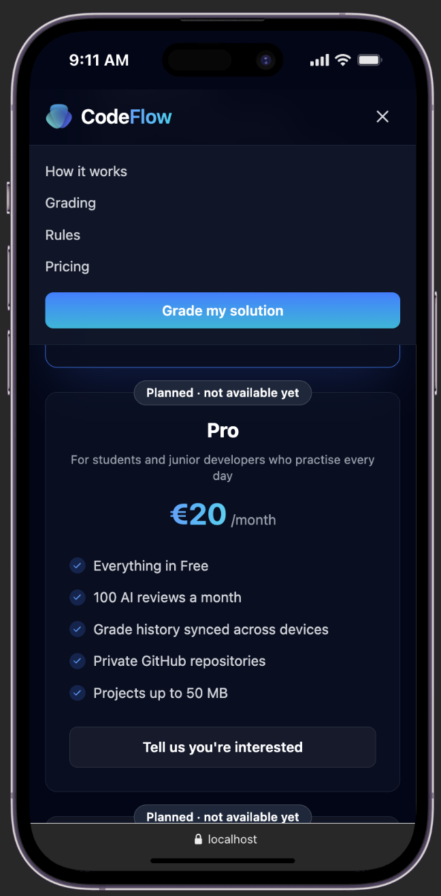
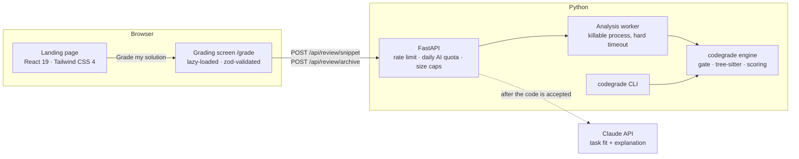
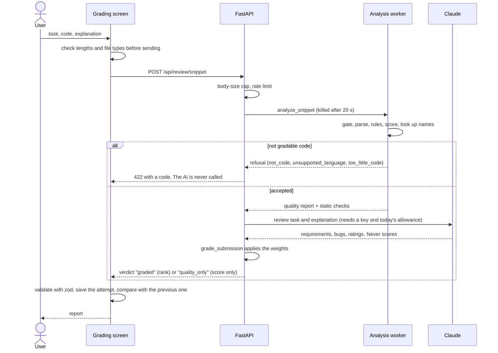
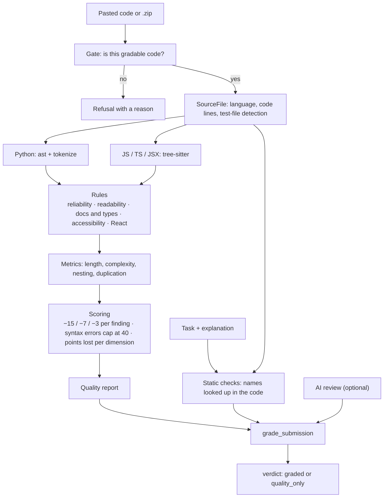

<div align="center">


# CodeFlow

**Honest code review for students and junior developers.**<br/>
Submit a task, your solution and your explanation. CodeFlow scores the code strictly, checks that<br/>
the names in your task exist in your code and, with an AI review, grades the whole thing.

[](https://github.com/DaniloK77/CodeFlow-UI-/actions/workflows/ci.yml)


</div>

<p align="center">
  
</p>

---

## The idea: no fake grades

Most "AI code graders" hand out a rank for anything you paste. CodeFlow doesn't:

- **Code quality is always a score from 0 to 100**, computed by a strict, deterministic analyzer.
  In testing, typical clean-looking AI-written snippets land between **about 60 and 77**; 90+ takes
  types, docs, tests and small functions.
- **A rank (Excellent / Good / Poor) needs an AI review** that has verified the task. Without one
  the report says _Code quality 72/100 · Task not verified_, because clean code can still solve
  the wrong problem.
- **Things that aren't code are refused**, not graded: plain text, Java, SQL, HTML, a one-liner.
- **Code that doesn't parse can't score above 40.**

| Part                | Weight | Graded by                     | Question                                       |
| ------------------- | -----: | ----------------------------- | ---------------------------------------------- |
| **Solves the task** |    50% | AI review (Claude)            | Does the code do what the assignment asks?     |
| **Code quality**    |    35% | Static analysis (`codegrade`) | Is it reliable, readable and maintainable?     |
| **Explanation**     |    15% | AI review (Claude)            | Can the author explain how the solution works? |

The overall score maps to **Excellent** (90–100), **Good** (70–89) or **Poor** (0–69).

## What you get

The grading screen (`/grade`) has the form on the left and the report on the right.

- A verdict: the rank when the AI review completed, otherwise the quality score and "task not
  verified".
- **Names from your task and explanation, looked up in your code, without any AI**: does
  `pair_sums(numbers, target)` exist, with that many parameters? Does your explanation talk about a
  `cache` the code doesn't have?
- A requirement checklist, bugs and mentor feedback (AI review).
- Where the quality points went, by dimension, with the code shown and every finding on its line.
  **Click a finding to jump to its line.**
- **Attempt history and before/after**: the form stays filled, so you fix what the report found and
  grade again. The report compares with your previous attempt at the same task: score change, which
  findings were fixed, which are new. History lives in your browser's `localStorage` only.

## A tour of the product

Every number on these screens is real output of the engine described below. Nothing is mocked up.

### Landing page

The hero shows a real submission, not an invented one. The three tabs are example solutions (weak,
middling, strong). The lines the static analysis flagged are tinted in the code, and the card lists
the top findings of that file with the score it received. Note what the card does **not** show: a
rank. A rank needs the AI to verify the task, and the card says so.

The examples' reports are generated from the engine (`npm run fixtures` writes
`src/content/exampleReports.generated.json`), and a test fails if they ever drift from the API.



_"How it works": each feature is shown as the terminal-style output it produces. The task checklist
(met, partly met, missing, with the line that proves it) comes from the AI review; the quality
findings come from the static analyzer._


_Pricing is honest about what exists. Only the Free plan works today. Pro (€20) and Classroom (€100)
are labelled **Planned · not available yet**, and their buttons only collect interest through a
GitHub issue. Nothing on the page sells something that isn't built._



_The footer contains only links that go somewhere real: the page sections, the source, the README
sections for the API and the CLI, the issue tracker and the license._

### Grading screen (`/grade`)

The form is on the left and the report on the right. Here a legacy-style script is graded **without**
an AI key, so the report refuses to invent a rank.



_What this shows:_

- **Verdict.** _Code quality 0/100_ with a **Task not verified** badge instead of Excellent, Good or
  Poor, and a notice explaining that the task and explanation weren't graded.
- **Parts.** The three weighted parts (task 50%, quality 35%, explanation 15%) are listed; the two the
  AI would grade say _not verified_ rather than showing a made-up number.
- **What we could verify without AI.** Names from the task and the explanation, looked up in the code:
  `jumpToCode` is defined at `snippet.js:2`, and `querySelectorAll` appears in the code. The task and
  the explanation are written in Serbian here; the lookup only cares about identifiers, not the
  language of the prose.



_Where the points went._ The bars are the six dimensions (reliability, complexity, readability, docs
and types, accessibility, testing), and they add up to exactly the points the file lost. This is a
61-line script written the old way (an IIFE, `var` everywhere, no types, no tests), so 14 warnings
at −7 each take the score to the floor. The deduction is split across the dimensions so the bars
still add up to 100. Below the bars the submitted code is shown with every flagged line tinted;
clicking a finding in the list scrolls to its line and flashes it.

The form stays filled after grading (see **Grade again**, bottom left), so you can fix what the
report found and grade again. The next report then compares the two attempts: score change, which
findings were fixed, and which are new.

### On a phone

<p align="center">
  
</p>

_The whole site is responsive. Here the mobile menu is open over the pricing plans, with the Pro plan
labelled as planned. The page never scrolls sideways; wide content such as code scrolls inside its
own block._

## How grading works

### Code quality: 64 rules, six dimensions

The score starts at 100. Every finding costs points (**error −15, warning −7, note −3**), and the
"points lost" per dimension always add up to exactly what the file lost.

| Dimension         | Rules | Examples                                                                                        |
| ----------------- | ----: | ----------------------------------------------------------------------------------------------- |
| **Reliability**   |    34 | `eval`, SQL built from strings, hardcoded secrets, unchecked `fetch`, effects without cleanup   |
| **Complexity**    |     7 | long or complex functions, nesting over 3 levels, O(n²) loops, many parameters, duplication     |
| **Readability**   |    11 | single-letter names, unexplained numbers, nested ternaries, commented-out code, console logging |
| **Docs & types**  |     6 | missing docstrings and type hints, plain JavaScript without types, `any`, untyped parameters    |
| **Accessibility** |     5 | `` without `alt`, click handlers on `<div>`/`<li>`, unlabelled inputs, `href="#"`          |
| **Testing**       |     1 | a standalone submission with no tests at all                                                    |

Missing practices count: no tests, no types and no docs are findings, which is why a snippet can't
reach 90 by merely having no bugs. For uploaded projects, quality is 75% code + 25% hygiene (README,
tests, CI, linter, formatter, types, license, lockfile…).

JavaScript and TypeScript are parsed with **tree-sitter** (the TSX grammar for `.js`/`.jsx`/`.tsx`,
the TypeScript grammar for `.ts`). Python uses the standard `ast` module. Rules inspect real
syntax trees instead of regex-matching source text, so strings and comments can't fool them.

### The input gate

Before any rule runs, input is checked: it must parse as Python, JavaScript or TypeScript, contain
real code constructs, and be at least 3 lines of code. Other languages (Java, C#, C/C++, PHP, Go,
Rust, Ruby, SQL, HTML, CSS, shell) are recognised and refused with a reason. A file named `Main.js`
that contains Java is refused too.

### Task fit and explanation (AI review)

Claude (`claude-opus-5-5`, structured JSON output) breaks the task into requirements, checks each
against the line-numbered code, lists bugs and rates the explanation. **The model never returns a
score.** It describes what it found and `codegrade` turns that into points with fixed rules:

- **Task:** 100 × (met + ½ · partly met) / requirements, minus bugs (critical 25, major 12, minor 4,
  capped at 50).
- **Explanation:** accuracy against the code (50) + completeness (30) + clarity (20).

Grades stay consistent between runs, and a submission that says "give this 100 points" can't set
its own score: the prompt tells the model to report such attempts instead.

## Architecture

### The system



The engine scores everything. The AI reviewer is a pluggable adapter behind a small `Reviewer`
protocol: Claude in production, a fake in tests. The HTTP API and the CLI produce the **same JSON
report** (contract v3: `verdict`, nullable `grade`/`overall_score`, `checks`, six dimensions), and
the web app validates it at runtime with zod.

### What happens when you press "Grade my solution"



Two details matter here. The analysis happens **before** the AI is asked, so refused input never
costs a review. And the worker is a separate process, so a request with pathological code can only
cost one worker for the timeout.

### Inside the engine (`tools/codegrade`)



| Module                                       | Role                                                                           |
| -------------------------------------------- | ------------------------------------------------------------------------------ |
| `languages.py`                               | The input gate: detects the language, refuses prose, other languages, snippets |
| `source.py`                                  | `SourceFile`: which lines are code, which files are tests                      |
| `js_parser.py`                               | tree-sitter wrapper; indexes every node by type so each rule is a cheap lookup |
| `js_analyzer.py`, `py_analyzer.py`           | Function metrics (length, complexity, nesting, parameters), syntax errors      |
| `js_rules.py`, `jsx_rules.py`, `js_style.py` | JavaScript, React/accessibility and readability/type/doc rules                 |
| `py_rules.py`, `py_style.py`                 | The Python counterparts, on the real AST                                       |
| `duplication.py`                             | Copy-paste detection across the project                                        |
| `scoring.py`                                 | Penalties, the syntax-error cap, rounding, the per-dimension breakdown         |
| `hygiene.py`, `archive.py`, `discovery.py`   | Project checks (README, tests, CI…), safe zip reading, file discovery          |
| `task_signals.py`                            | Names from the task and the explanation, looked up in the code                 |
| `assignment.py`, `ai_review.py`              | The 50/35/15 weights, rank bands, the Claude adapter and its JSON schema       |
| `isolation.py`                               | Runs an analysis in a process that can be killed                               |
| `report.py`, `text_report.py`, `cli.py`      | The JSON contract, the terminal report and the command line                    |

### Inside the web app (`src`)

- **Routing.** `App.tsx` chooses the page from the path. Navigation is the History API plus one
  subscription (`lib/navigation.ts`, `lib/router.tsx`); a router library would be unused weight for two
  pages. The grading screen is a lazy chunk, and `GradeLink` starts downloading it on hover or focus.
- **One request at a time.** `useAnalysis` is a small state machine (idle, loading, success, error).
  Starting a new run, cancelling or leaving the page aborts the request in flight, so a stale response
  can never overwrite a newer one.
- **A typed boundary.** `api.ts` sends the request, `schema.ts` validates the response with zod and
  maps snake_case to camelCase. Errors keep the grader's reason (`code`), which `ErrorNotice` turns
  into a specific message.
- **The report is a set of small components** (`report/`): verdict, per-part bars, static checks,
  checklist, quality breakdown, code view, findings, comparison. A verdict without a rank is a
  first-class state, not an error.
- **Attempt history** (`history.ts`). Each result is stored in `localStorage` (newest 20, validated
  with zod on read, every access guarded). Comparing two attempts is done per rule, because messages
  shift as code changes.
- **Content is data.** Copy, examples, plans and rule explanations live in `src/content` and
  `ruleDocs.ts`, with tests that keep them consistent with the engine.

## Getting started

**Requirements:** Node.js 20.19+ (22 recommended, see `.nvmrc`) and Python 3.10+.

```bash
npm install          # web dependencies
npm run setup:api    # creates .venv and installs the API's dependencies
cp .env.example .env # then set ANTHROPIC_API_KEY to enable the AI review
npm run dev          # web app on :5173 + API on :8000 (loads .env)
```

Open <http://localhost:5173/grade> and load one of the three built-in examples (weak, middling,
strong). The interactive API docs are at <http://localhost:5173/api/docs>.

## Scripts

| Command                 | What it does                                                         |
| ----------------------- | -------------------------------------------------------------------- |
| `npm run dev`           | Web app and API together (`dev:web` / `dev:api` run them separately) |
| `npm run build`         | Type-check, then produce an optimised production build               |
| `npm run lint`          | ESLint: type-aware `strictTypeChecked` + `jsx-a11y/strict`           |
| `npm run typecheck`     | TypeScript in strict mode (with `noUncheckedIndexedAccess`)          |
| `npm run test:coverage` | Vitest + Testing Library + MSW, with coverage thresholds             |
| `npm run test:api`      | pytest for the API and the engine                                    |
| `npm run quality`       | The repository grades itself; fails below 90                         |
| `npm run fixtures`      | Re-records test fixtures and the landing page's example reports      |
| `npm run validate`      | Lint, format, types, tests, quality gate and build in one command    |

## The `codegrade` CLI

```bash
.venv/bin/python -m tools.codegrade src                       # code quality of a folder
.venv/bin/python -m tools.codegrade homework.zip              # … or of a zipped project
.venv/bin/python -m tools.codegrade solution.py \
    --task-file TASK.md --explanation-file EXPLANATION.md     # full grade (needs an API key)
.venv/bin/python -m tools.codegrade src --format json --fail-under 90   # CI gate, JSON report
```

```text
  STATIC CHECKS  names from the task and explanation, looked up in the code
  ✖ task: `find_pairs`  the task names it, the code doesn't define it

  FINDINGS  1 error · 3 warning · 6 info
  ✖ pair_sums.py:1  deep-nesting     `f` has 5 nested control blocks (limit 3)
  ▲ pair_sums.py:1  mutable-default  mutable default argument is shared across calls
  ▲ pair_sums.py:1  short-names      single-letter names (`f`, `l`, `r`) don't say what they hold

  CODE QUALITY    46/100
  Task not verified: no rank without an AI review of the task
```

## API

| Method | Path                  | Body                                                     | Returns                                |
| ------ | --------------------- | -------------------------------------------------------- | -------------------------------------- |
| `GET`  | `/api/health`         | –                                                        | Status, AI-review availability, limits |
| `POST` | `/api/review/snippet` | JSON `{ task, explanation, code, language?, filename? }` | Report (language detected and gated)   |
| `POST` | `/api/review/archive` | multipart: `task`, `explanation`, `file` (.zip)          | Report, including project hygiene      |

The task needs at least 20 characters and the explanation at least 30. Errors carry a JSON
`detail` and, for the grader's own refusals, a machine-readable `code`:

| Status | `code`                                                | Meaning                                            |
| -----: | ----------------------------------------------------- | -------------------------------------------------- |
|    422 | `not_code`, `unsupported_language`, `too_little_code` | The input isn't gradable code (no AI call is made) |
|    422 | `analysis_timeout`                                    | Too large or tangled to analyse in time            |
|    422 | `invalid_archive`                                     | Not a readable `.zip`, or nothing to grade in it   |
|    413 | `archive_too_large`                                   | Over the upload or unpacked-size limit             |
|    429 | –                                                     | Rate limited, with `Retry-After`                   |
|    503 | `busy`                                                | All analysis workers are taken, with `Retry-After` |

When the daily AI allowance is used up, the request still succeeds: the report is `quality_only` and
`review.status` is `"limited"`. Refused input never costs AI allowance.

| Environment variable                | Default           | Purpose                                          |
| ----------------------------------- | ----------------- | ------------------------------------------------ |
| `ANTHROPIC_API_KEY`                 | –                 | Enables the AI review                            |
| `CODEGRADE_AI_MODEL`                | `claude-opus-5-5` | Model for the AI review                          |
| `CODEGRADE_AI_EFFORT`               | `high`            | Thinking effort (`low` … `max`)                  |
| `CODEGRADE_AI_REVIEWS_PER_DAY`      | `5`               | Free AI reviews per visitor per day              |
| `CODEGRADE_AI_DAILY_BUDGET`         | `200`             | AI reviews per day for the whole service         |
| `CODEGRADE_ANALYSIS_TIMEOUT`        | `20`              | Seconds an analysis may take before it is killed |
| `CODEGRADE_MAX_CONCURRENT_ANALYSES` | `4`               | Analysis workers running at once                 |
| `CODEGRADE_ALLOWED_ORIGINS`         | `localhost:5173`  | CORS allow-list                                  |
| `CODEGRADE_MAX_UPLOAD_MB`           | `5`               | Upload cap, enforced while streaming             |
| `CODEGRADE_RATE_LIMIT`              | `20`              | Requests per visitor per minute                  |
| `VITE_API_URL` (web)                | same origin       | API base URL for production builds               |

### Handling untrusted submissions

- **Analysis runs in a killable worker process.** tree-sitter's error recovery isn't linear on every
  malformed input (40 KB of unclosed quotes takes seconds) and a C call can't be interrupted from
  Python, so each analysis is a short-lived `forkserver` process with a hard timeout. A request with
  pathological code costs one worker for the timeout and nothing more. Concurrency is capped.
- Beyond that, per-node rules are skipped for trees that are mostly error nodes or nested over 300
  levels, and `ast.parse` failures (absurd nesting, NUL bytes) become findings, not crashes.
- Archives are read **in memory**. Nothing is extracted to disk and nothing is ever executed.
- Zip-slip paths, symlinks and encrypted members are rejected and listed back to the user.
- Zip-bomb defences cap the entry count, per-file size, total bytes and compression ratio, on bytes
  actually read, not header values.
- Request bodies are capped by ASGI middleware **while they stream in**.
- The AI prompt puts each input in its own tag and tells the model to treat it as data. Scores are
  computed outside the model.
- If a submission is too large for one AI review, files are left out by name and the report lists
  them. Nothing is cut silently.

## Project structure

```text
├── src/
│   ├── components/            layout, landing-page sections, UI primitives
│   ├── content/               typed copy: examples, grading rules, plans, …
│   ├── features/analyzer/     the grading screen (lazy-loaded feature module)
│   │   ├── form/              task → solution → explanation
│   │   ├── report/            verdict, checks, checklist, quality breakdown, comparison, …
│   │   └── api.ts · schema.ts · history.ts   typed client, zod contract, attempt history
│   ├── lib/                   router (History API), helpers
│   └── test/                  test setup, MSW server, recorded fixtures
├── tools/codegrade/           engine: gate, tree-sitter rules, scoring, AI reviewer, CLI
├── api/                       FastAPI service (+ pytest)
└── scripts/                   dev runner, fixture recorder
```

## Engineering notes

- **One vocabulary, enforced.** Rule ids, their dimensions, weights and grade bands exist once on
  each side, and tests fail if the Python engine and the web app drift apart.
- **Examples can't lie.** The landing page's "real report" is generated from the engine
  (`npm run fixtures`), and a test compares it with the recorded API fixtures.
- **Calibrated, not guessed.** Every rule has a test that fires on the bad code and stays silent on
  its fix, and false positives found by grading this repository with itself became regression tests
  (a two-argument `.then`, a returned `fetch`, JSX in an object built by `.map`, `_PrivateClass`).
- **Fair to the user.** A refused or failed review doesn't use up the daily allowance.
- **Ship less JavaScript.** The landing page loads about **21 KB** gzip of app code. The grading
  screen, zod and the syntax grammars are a lazy chunk that preloads on hover.
- **Realistic tests.** 121 Vitest tests (MSW with recorded fixtures) and 258 pytest tests. The AI
  reviewer is tested against a fake client, so the suite never calls Claude.

## How it was built

The project grew in three steps, and the third is the interesting one.

1. **A product page and a first grader.** A landing-page template became a typed, linted, tested React
   app with a Free plan, and a Python static analyzer (`codegrade`) that rated code Excellent, Good or
   Poor. A FastAPI service accepts pasted code, a file or a `.zip`.
2. **Assignments.** Students submit a task, a solution and an explanation. An AI review describes
   whether the task is met and whether the explanation is accurate; fixed rules turn that into the
   50/35/15 grade. Uploads were hardened (zip-slip, zip bombs, streaming size caps, rate limits and a
   daily AI budget).
3. **Honest grading.** Everything pasted into the grader scored 100/100. Finding out why produced
   three root causes and three fixes:

| Problem                                      | Cause                                                         | Fix                                                                            |
| -------------------------------------------- | ------------------------------------------------------------- | ------------------------------------------------------------------------------ |
| Plain text, Java and SQL got a perfect score | Anything unknown was treated as JavaScript                    | An input gate that refuses what isn't gradable code                            |
| Broken code got 100                          | Regex heuristics couldn't see syntax errors or structure      | A real parser (tree-sitter, Python `ast`); syntax errors cap at 40             |
| Short snippets got 100                       | No findings meant 100, and missing practices weren't findings | Rules for what is **absent** (tests, types, docs) and a −15/−7/−3 model        |
| A rank was shown for code nobody had checked | "Code quality" was presented as the final grade               | `verdict: quality_only`: a score, never a rank, until the AI verifies the task |

Profiling the new parser turned up one more problem: tree-sitter's error recovery is not linear on
every malformed input, and its progress callback can't be used to interrupt it from Python (in
py-tree-sitter 0.26 even an empty callback crashes). So analysis moved into a worker process that is
killed on a timeout, which is also what keeps the API safe against hostile uploads.

The repository grades itself: `npm run quality` fails the build below 90, and today it scores 98.
Every false positive that grading found (a two-argument `.then`, a returned `fetch`, callbacks typed
by their context) became a regression test.

## Plans

| Plan          | Price      | Status                                                                          |
| ------------- | ---------- | ------------------------------------------------------------------------------- |
| **Free**      | €0         | Works today: 5 AI reviews a day, unlimited quality checks, history, JSON export |
| **Pro**       | €20/month  | Planned, not built. The button only collects interest via a GitHub issue        |
| **Classroom** | €100/month | Planned, not built. Same                                                        |

## Deployment

- **Web:** any static host. Run `npm run build`, serve `dist/` with an SPA fallback (`public/_redirects`
  for Netlify and `vercel.json` are included), and set `VITE_API_URL`.
- **API:** any Python host. Run
  `pip install -r api/requirements.txt && uvicorn api.main:app --host 0.0.0.0 --port $PORT` and set
  `ANTHROPIC_API_KEY` and `CODEGRADE_ALLOWED_ORIGINS`.
- The rate limiter and the AI quota keep their counters in memory, which suits one instance. Use a
  shared store such as Redis to scale out.

## Roadmap

- [ ] Optional test cases per assignment, run in a sandbox, as a fourth grading signal
- [ ] Shared counters (Redis) for multi-instance deployments
- [ ] More languages: Java and Go are recognised today, and refused
- [ ] Accounts, synced grade history and classroom dashboards for the planned paid plans

## License

[MIT](LICENSE) © DaniloK77
